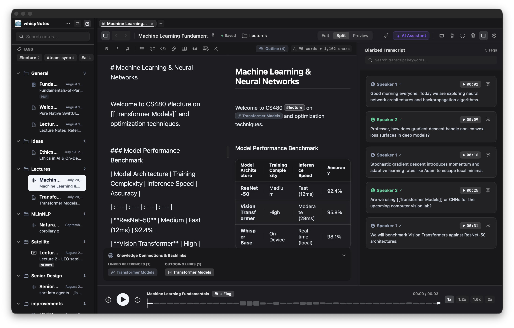
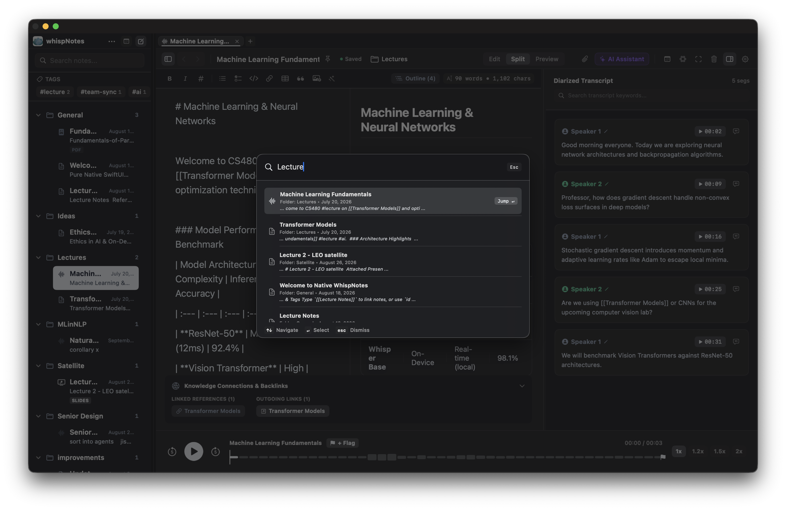
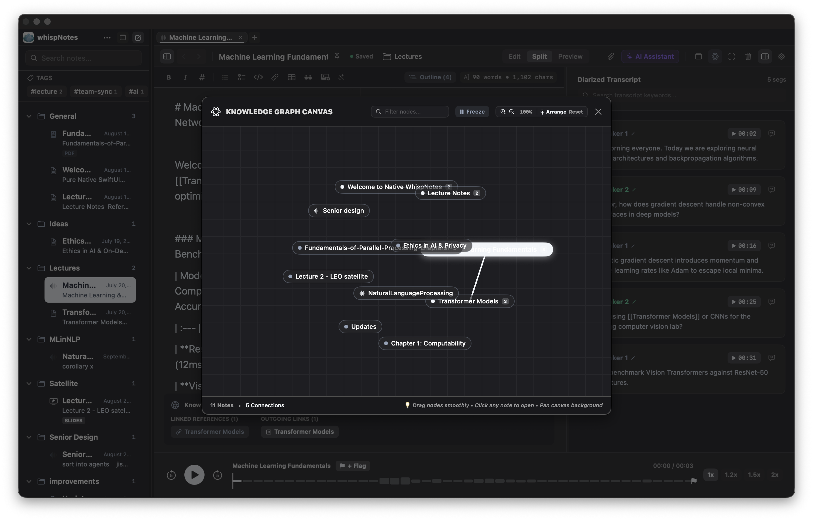

# WhispNotes

[](https://apple.com)
[](https://swift.org)
[](LICENSE)
[](https://github.com/GIlbertoRCP/whispNotes/actions/workflows/ci.yml)

**WhispNotes** is a pure native macOS application for markdown note-taking with integrated on-device audio transcription and local Gemma 3 AI assistant capabilities. Designed for privacy and offline usage, all note data, speech processing, and AI generation remain 100% local to your machine with **zero background HTTP servers or external API ports**.

---

## Quick Download & Direct Installation (No Terminal Required)

1. Download **`WhispNotes-1.6.0.dmg`** from the latest [GitHub Releases](https://github.com/GIlbertoRCP/whispNotes/releases).
2. Double-click **`WhispNotes-1.6.0.dmg`** to open the installer.
3. Drag **`WhispNotes.app`** into your **`Applications`** folder.
4. Launch **WhispNotes** directly from Applications or Spotlight (`⌘Space`)!

> **Zero terminal setup required.** Models for offline transcription and Gemma 3 AI assistant features can be downloaded on-demand directly inside the app's **Settings** modal with a single click.

---

## Interface Preview

### Main 3-Pane Interface & Diarized Audio Transcription


### Spotlight Command Palette (⌘K)


### Interactive Knowledge Graph Canvas (⌘G)


---

## Key Features

- **Intelligent Paste Formatting & Structure Reconstruction**:
  - Automatically parses rich web copies and HTML tables into GitHub-flavored Markdown tables.
  - Converts KaTeX math elements into standard `$math$` syntax notation.
  - Plain-text heuristic formatting: unglues concatenated headings, restores bullet hierarchies, and converts flattened text into clean pipe tables.
  - Native shortcuts: `⌘V` (Smart Paste with toast notification), `⌥⇧⌘V` (Raw Plain Text Paste), and `⌥⌘F` (Format & Beautify Note) with full Undo (`⌘Z`) support.
- **Obsidian-Style Global GUI Zoom**:
  - Seamless proportional UI scaling from `0.70x` to `1.80x` (10% increments) with `⌘+` / `⌘=` (Zoom In), `⌘-` (Zoom Out), and `⌘0` (Reset to 100%).
  - Floating glassmorphic HUD pill displaying active zoom percentage, with persistent state across app launches.
- **Three-Pane Split View & Typography**:
  - Navigate notes via the hierarchical folder & tag sidebar, write in the live-rendered Markdown editor with word-level multiline wrapping, and view time-synced transcripts in the right panel.
  - Beautiful zebra-striped Markdown tables, inline math formulas (`$formula$`), wiki-links, and syntax highlighting.
- **Interactive Knowledge Graph Canvas (`⌘G`)**:
  - Force-directed visual node graph of note connections with draggable node physics, blueprint grid canvas, zoom/pan controls, and search filtering.
- **Quick Record from Anywhere**:
  - Start or stop a recording with the global shortcut `⌃⌥⌘R` or the menu bar icon, without leaving your call. The icon shows the elapsed time while recording.
  - Recordings always land in the note they were started in, even if you switch notes mid-meeting.
- **Editor Preferences**:
  - Choose the default view (Edit, Split or Preview) and the reading width (Narrow, Standard, Wide or Full Width) in Settings › Editor.
- **On-Device Whisper Speech-to-Text**:
  - High-precision local speech transcription with zero external API calls or background servers.
  - Multi-speaker diarization with speaker segment pills and active transcript auto-scrolling during playback.
  - One-click transcript blockquote insertion (`> "quote" [01:23](play://83)`).
- **Interactive Audio Waveform Seeker**:
  - Click or drag along the multi-bar audio waveform to seek playback instantly, with live playhead indicator, timestamp readouts, and playback speeds (`1×`, `1.25×`, `1.5×`, `2×`).
- **Native PowerPoint (`.pptx`) & PDF Presentation Support**:
  - Zero external dependencies: native OpenXML slide parsing and presenter notes extraction.
  - Interactive 16:9 widescreen presentation canvas with slide navigation, slide counter, jump-to-slide popover, and one-click slide citations.
- **On-Device Gemma 3 Local AI Assistant**:
  - Extract executive key takeaways, auto-detect action items, generate study flashcards, and run custom Q&A on your active note context completely offline.
- **Spotlight Command Palette (`⌘K`)**:
  - Instant fuzzy search across notes, folders, and transcript content with folder badges and keyboard navigation.
- **Real-Time Release & Update Status**:
  - Live version checks in Settings displaying update availability, release notes, and direct DMG download links.
- **Multi-Format Note Export Suite**:
  - Export notes with customizable typography and formatting to Markdown, PDF, and Plain Text.
- **Dynamic Theme Engine**:
  - Switch between curated themes: Default Dark, Cyberpunk Neon, Obsidian Dark, Solarized Dark, and Minimalist Light.
- **Trash Bin Retention & Data Safety**:
  - Notes move to the Trash first, restore to their original folder, and can be deleted permanently from there (undoable with ⌘Z).

---

## System Requirements

- macOS 14.0 (Sonoma) or higher
- Apple Silicon (M1/M2/M3/M4) or Intel Mac

---

## Building from Source (For Developers)

To build and run the executable locally using Swift Package Manager:

```bash
swift build
swift run
```

### Running Unit Tests

To run the automated SPM unit test suite:

```bash
swift test
```

### Packaging `.app` Bundle & DMG Installer

To compile, code-sign, and package the application into a standalone macOS `.app` bundle and compressed `.dmg` disk image:

```bash
./scripts/build_app.sh 1.6.0
```

This script generates:
- `build/WhispNotes.app` (signed macOS application bundle with custom app icon)
- `build/WhispNotes-1.6.0.dmg` (installer image with Applications drag-and-drop link)

---

## Project Architecture

- `Package.swift`: SPM package manifest specifying macOS targets, dependencies, and test targets.
- `Sources/App/`: Main application lifecycle, window management, and menu commands (`WhispNotesApp.swift`).
- `Sources/Models/`: Data structures for Notes, Transcripts, Themes, Models, Export configurations, and Graph Canvas nodes.
- `Sources/Services/`: Data persistence (`NotesDataManager`), Audio discovery & recording, Whisper transcription, SmartPasteEngine, ZoomManager, and Gemma 3 local AI engine.
- `Sources/ViewModels/`: Reactive audio recorder & player view models.
- `Sources/Views/`: Modular SwiftUI components (Sidebar, Split Editor, Audio Player Bar, Graph Canvas, Command Palette, PPTX / PDF Viewer, AI Study Assistant, Settings).
- `Tests/swift-whispnotesTests/`: Automated unit test suite covering Note serialization, Smart Paste heuristics, Exporter, and Wiki-Link parsing.
- `scripts/build_app.sh`: Automated build script to package `.app` bundle and compressed `.dmg` installer.
- `.github/workflows/`: CI/CD workflows for automated building, testing, and GitHub Release asset publishing.

---

## Local Storage Location

Application settings, models, and notes are stored locally as JSON in:

`~/Library/Application Support/com.whispnotes.app/`
*(Or under `~/Library/Containers/com.whispnotes.app/Data/Library/Application Support/com.whispnotes.app/` when running sandboxed)*

---

## License & Contributing

WhispNotes is licensed under the [MIT License](LICENSE).
Contributions are welcome! Please check out [CONTRIBUTING.md](CONTRIBUTING.md) for guidelines on code architecture, pull requests, and development setup.
